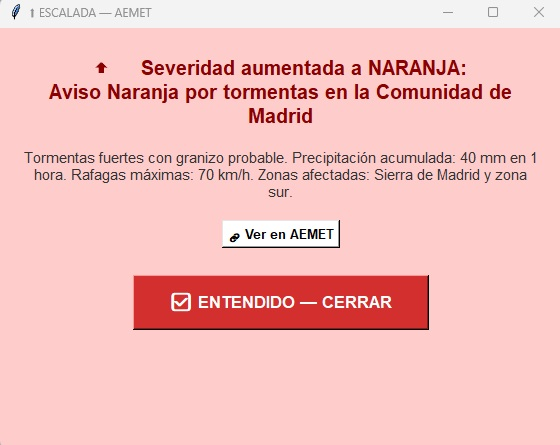
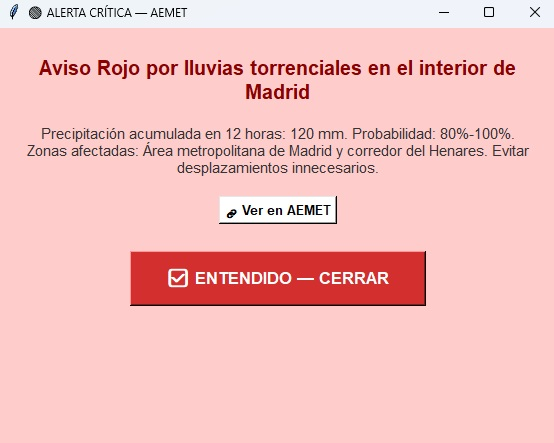
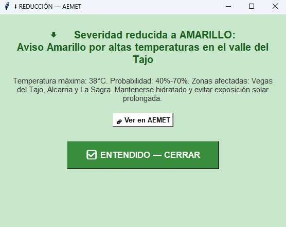
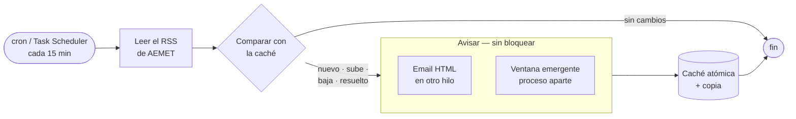

<div align="center">

# 🌩️ Monitor de avisos meteorológicos

**Vigila los avisos oficiales de AEMET y avisa al equipo de operaciones en cuanto uno aparece, empeora, baja o se resuelve.**


<sub><a href="README.md">🇬🇧 English</a> · 🇪🇸 Español</sub>

</div>

<table>
<tr>
<td align="center" width="33%"><br><sub>⬆️ Sube de nivel</sub></td>
<td align="center" width="33%"><br><sub>🔴 Crítico</sub></td>
<td align="center" width="33%"><br><sub>⬇️ Baja de nivel</sub></td>
</tr>
</table>

## 🏭 Por qué existe

En mis prácticas la empresa necesitaba información al día sobre el mal tiempo, pero no había nada automático que siguiera los avisos de AEMET. Lo escribí para que el equipo reciba un **email y una ventana en pantalla** a los pocos minutos de que AEMET publique o cambie un aviso de su zona. Allí corría en Windows; el mismo código funciona sin cambios en Linux.

## 💡 Por qué es sólido

- **Detecta cambios, no spamea** — solo avisa de avisos *nuevos*, que *suben*, *bajan* o *se resuelven*, cada uno con su color.
- **Nunca se queda colgado** — los emails salen en otro hilo y las ventanas son procesos aparte, así que cada ejecución programada termina.
- **Estado a prueba de cortes** — escritura atómica de la caché con copia automática, y limpieza de lo antiguo.
- **Aguanta una red inestable** — lectura del RSS con timeout y reintentos.
- **Los secretos fuera del código** — App Password de Gmail en variables de entorno / `.env`; logs rotativos (10 MB × 5).

## 🔁 Cómo funciona



## 🚀 Arranque rápido

```bash
pip install -r requirements.txt
AEMET_EMAIL=False python monitor_aemet.py      # solo ventanas, sin configurar email
```

Para el email, copia `env.example` a `.env`, pon una App Password de Gmail y los destinatarios en `destinatarios.txt`. Después prográmalo cada 15 minutos:

```cron
*/15 * * * * /usr/bin/python3 /ruta/a/monitor_aemet.py
```

Vale para cualquier zona de España: cambia `AEMET_RSS_URL` por el feed de la tuya.

---

<sub>📄 Documentación completa (configuración, arquitectura, todas las opciones) en [`docs/DETALLES.md`](docs/DETALLES.md). Licencia MIT.</sub>
