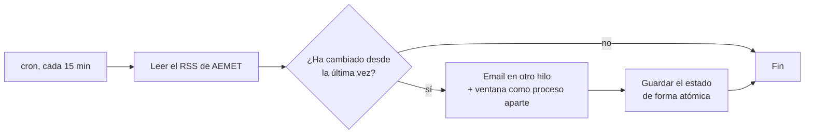

# Monitor de avisos de AEMET

[English](README.md)

Un script en Python que vigila los avisos meteorológicos oficiales de AEMET y avisa a un equipo cuando un aviso aparece, cambia de nivel o se resuelve. Lo escribí en mis prácticas, donde no había nada automático para seguir los avisos, y allí corría en Windows. En Linux funciona sin cambios.

<table>
<tr>
<td width="33%"><br><sub>Sube a naranja</sub></td>
<td width="33%"><br><sub>Aviso rojo</sub></td>
<td width="33%"><br><sub>Baja a amarillo</sub></td>
</tr>
</table>

## Cómo funciona



- Solo avisa de cambios: nuevo, sube, baja o resuelto, cada uno con su color.
- Los emails salen en otro hilo y las ventanas son procesos aparte, así que cada ejecución programada termina.
- El estado se guarda de forma atómica y con copia, y la lectura del RSS tiene timeout y reintentos.
- Las credenciales van en variables de entorno o en `.env`, nunca en el código. Los logs rotan a los 10 MB.

## Ponerlo en marcha

```bash
pip install -r requirements.txt
AEMET_EMAIL=False python monitor_aemet.py   # solo ventanas
```

Para el email, copia `env.example` a `.env`, pon una contraseña de aplicación de Gmail y los destinatarios en `destinatarios.txt`. Para otra zona, cambia `AEMET_RSS_URL`.

<sub>Documentación completa en [docs/DETALLES.md](docs/DETALLES.md). Licencia MIT.</sub>
