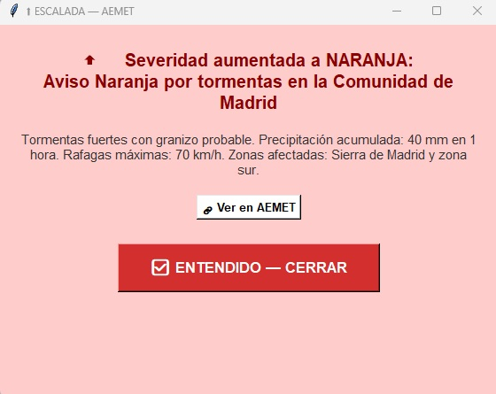
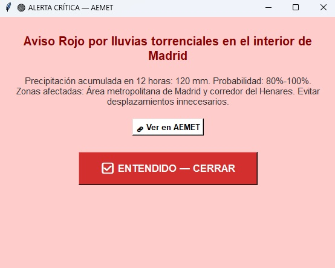
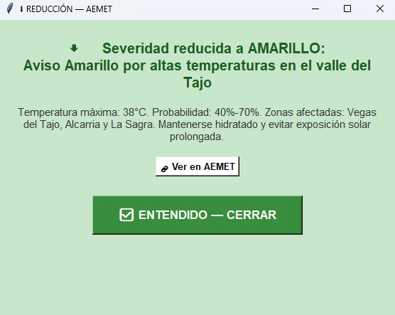
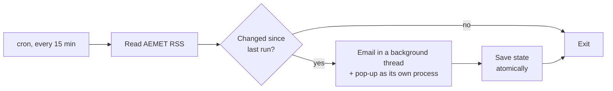

# Weather warning monitor

[Español](README.es.md)

A Python script that watches the official weather warnings from AEMET (Spain's met office) and lets a team know when a warning appears, changes level or clears. I wrote it during my IT internship, where there was no automated way to follow the warnings, and it ran there on Windows. It also runs unchanged on Linux.

<table>
<tr>
<td width="33%"><br><sub>Raised to orange</sub></td>
<td width="33%"><br><sub>Red warning</sub></td>
<td width="33%"><br><sub>Lowered to yellow</sub></td>
</tr>
</table>

## How it works



- It only notifies on changes: new, raised, lowered or cleared, each with its own colour.
- Emails go out on a separate thread and pop-ups are separate processes, so a scheduled run always finishes.
- State is written atomically with a backup, and the RSS fetch has a timeout and retries.
- Credentials come from environment variables or `.env`, never from the code. Logs rotate at 10 MB.

## Run it

```bash
pip install -r requirements.txt
AEMET_EMAIL=False python monitor_aemet.py   # pop-ups only
```

For email, copy `env.example` to `.env`, add a Gmail app password and put the recipients in `destinatarios.txt`. To watch another area, change `AEMET_RSS_URL`.

<sub>Full documentation in Spanish in [docs/DETALLES.md](docs/DETALLES.md). MIT license.</sub>
