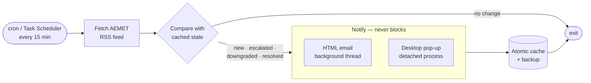

<div align="center">

# 🌩️ Severe-weather alert monitor

**Watches Spain's official weather warnings (AEMET) and tells the ops team the moment one appears, gets worse, eases or clears.**


<sub>🇬🇧 English · <a href="README.es.md">🇪🇸 Español</a></sub>

</div>

<table>
<tr>
<td align="center" width="33%"><br><sub>⬆️ Escalated</sub></td>
<td align="center" width="33%"><br><sub>🔴 Critical</sub></td>
<td align="center" width="33%"><br><sub>⬇️ Downgraded</sub></td>
</tr>
</table>

## 🏭 Why it exists

During my IT internship the company needed up-to-date information on severe weather, but there was no automated way to track AEMET warnings. I wrote this so the team gets an **email and a pop-up on screen** within minutes of AEMET publishing or changing a warning for their area. It ran there on Windows; the same code runs unchanged on Linux.

## 💡 What makes it solid

- **Change detection, not spam** — it only notifies on *new*, *escalated*, *downgraded* or *resolved* warnings, each with its own colour code.
- **Never hangs** — emails go out on a background thread and pop-ups run as detached processes, so a scheduled run always finishes.
- **Crash-safe state** — atomic cache writes with an automatic backup, and old entries are pruned.
- **Survives a flaky network** — RSS fetch with timeout and retries.
- **Secrets stay out of the code** — Gmail App Password from environment variables / `.env`; rotating logs (10 MB × 5).

## 🔁 How it works



## 🚀 Quick start

```bash
pip install -r requirements.txt
AEMET_EMAIL=False python monitor_aemet.py      # pop-ups only, no email setup needed
```

For email, copy `env.example` to `.env`, add a Gmail App Password and list recipients in `destinatarios.txt`. Then schedule it every 15 minutes:

```cron
*/15 * * * * /usr/bin/python3 /path/to/monitor_aemet.py
```

Any Spanish region works: change `AEMET_RSS_URL` to your zone's feed.

---

<sub>📄 Full documentation (in Spanish: configuration, architecture, every option) in [`docs/DETALLES.md`](docs/DETALLES.md). MIT licensed.</sub>
